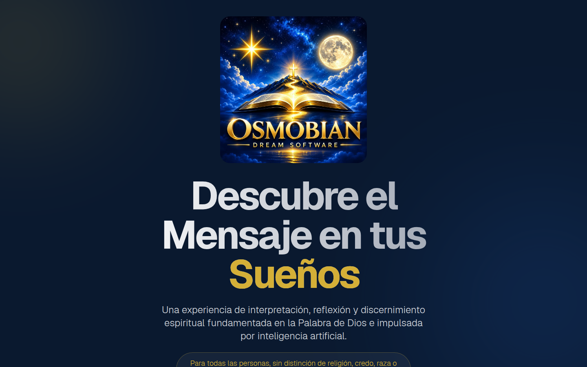
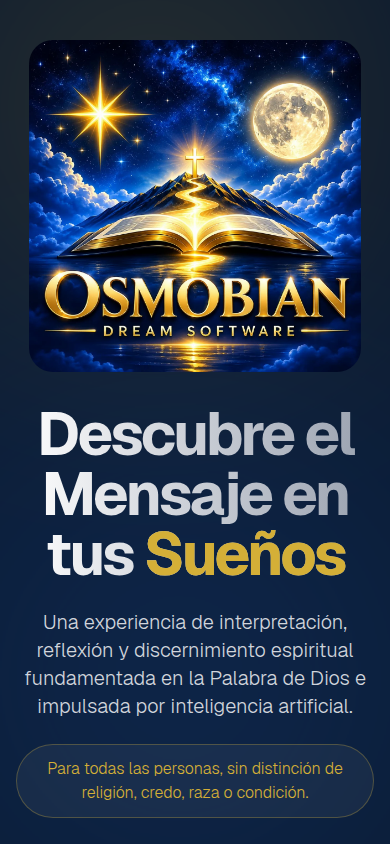
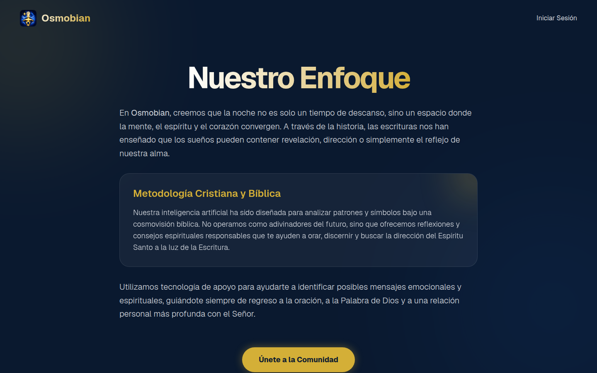

# Osmobian — Caso de estudio

[English](README.md) | **Español**

> Plataforma de reflexión sobre sueños asistida por IA, entregada como aplicación web instalable (PWA) con cuentas, plan de pago y panel de administración. Construida y puesta en producción como proyecto freelance.
>
> 🌐 **En producción:** [osmobian.com](https://osmobian.com) · 🔒 El código es privado (trabajo para un cliente). Recorrido disponible bajo petición.

  
  

## El producto

Osmobian permite registrar sueños y recibir una reflexión generada con IA y fundamentada en la Escritura, con un chat de seguimiento por sueño, historial personal y estadísticas. Un plan **Premium** de pago habilita funciones adicionales, entre ellas consultas personales que responde un administrador.

## Qué construí

| | |
|---|---|
| **App web / PWA** | Responsive, instalable en Android, iOS y escritorio, con aviso de instalación propio. |
| **Análisis con IA** | Integración con un modelo de lenguaje para analizar cada sueño, reintentar si falla y sostener un chat de seguimiento. |
| **Cuentas y roles** | Registro, inicio de sesión y tres niveles de acceso (usuario, premium, administrador). |
| **Pagos en línea** | Checkout con una pasarela colombiana, verificación de eventos firmados, validación de montos y vencimiento automático del periodo premium. |
| **Panel de administración** | Usuarios, pagos, consultas, estadísticas y pagos manuales. |
| **Correo** | Notificaciones transaccionales de consultas. |
| **Operación** | Despliegue en contenedores, migraciones automáticas de base de datos, tareas programadas y producción en un VPS. |

  

## Stack

`TypeScript` · `Next.js` · `React` · `Tailwind CSS` · `PWA` · `NestJS` · `Prisma` · `MariaDB` · `JWT` · `Docker` · `Coolify` · `Cloudflare` · `pnpm workspaces`

Monorepo con un frontend en Next.js y una API en NestJS sobre una base de datos relacional, más integraciones con un proveedor de IA, una pasarela de pagos y un servicio de correo.

## Aspectos técnicos destacados

- **Pagos en los que se puede confiar.** Las confirmaciones de pago se verifican criptográficamente, se validan montos y moneda, y la API puede conciliar un pago con el proveedor si una notificación llega tarde.
- **Protección contra abuso.** Límite de peticiones, validación de entradas, contraseñas con hash y ningún secreto por defecto: la API se niega a arrancar sin una clave de firma robusta.
- **Resiliente por diseño.** Si falla el proveedor de IA o el correo, el fallo queda contenido: el usuario puede reintentar un análisis y un error de correo nunca rompe la operación principal.
- **Acceso por roles.** Guards en cada ruta protegida y un área de administración separada.
- **Fácil de entregar.** Imágenes de producción, migraciones aplicadas al arrancar y manuales técnico y de administrador escritos para el cliente.

## Resultados

- En producción en [osmobian.com](https://osmobian.com).
- Entrega de punta a punta, con documentación y materiales de traspaso.

## Mi rol

Único desarrollador: diseño, desarrollo y despliegue. El mantenimiento y el soporte se prestan bajo un contrato de servicio, con alcance definido.

---

*El código fuente, los prompts y los detalles de negocio son información confidencial del cliente. Con gusto converso sobre el enfoque técnico en una entrevista.*
