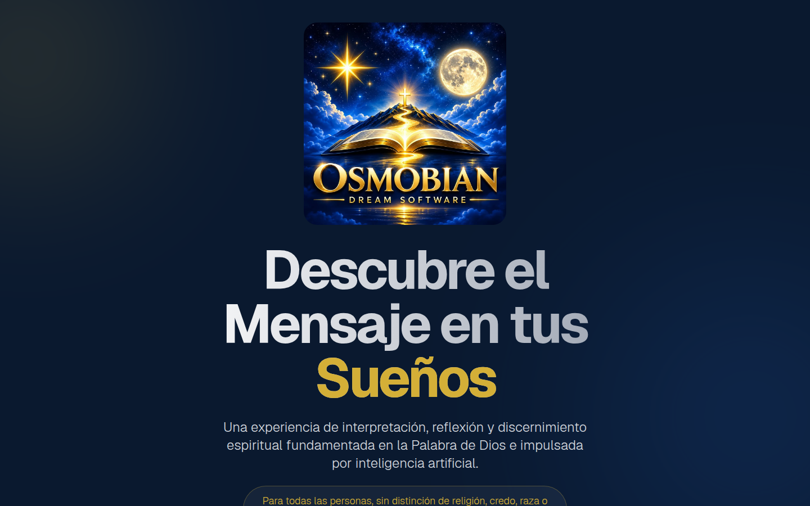
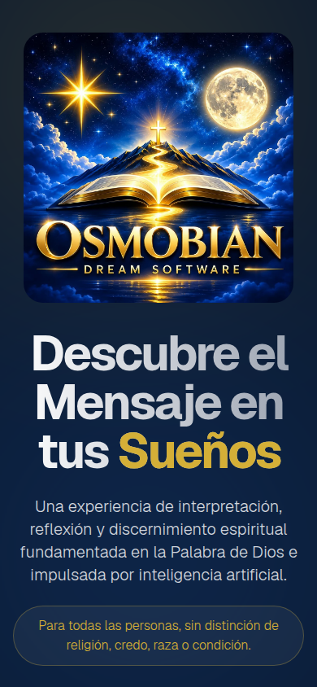
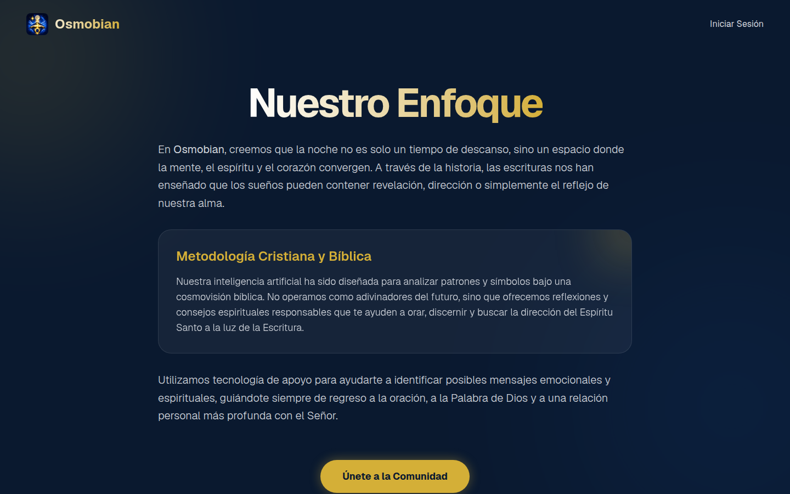

# Osmobian — Case Study

**English** | [Español](README.es.md)

> AI-assisted dream reflection platform, delivered as an installable web app (PWA) with accounts, a paid plan and an admin panel. Built and shipped to production as a freelance project.
>
> 🌐 **Live:** [osmobian.com](https://osmobian.com) · 🔒 Source code is private (client work). Walkthrough available on request.

  
  

## The product

Osmobian lets users record their dreams and receive an AI-generated reflection grounded in Scripture, with a follow-up chat per dream, a personal history and statistics. A paid **Premium** plan unlocks extra features, including personal consultations answered by an administrator.

## What I built

| | |
|---|---|
| **Web app / PWA** | Responsive, installable on Android, iOS and desktop, with a custom install prompt. |
| **AI analysis** | Integration with a large language model to analyze each dream, retry on failure and sustain a follow-up chat. |
| **Accounts and roles** | Registration, login and three access levels (user, premium, admin). |
| **Online payments** | Checkout with a Colombian payment provider, signed-event verification, amount validation, automatic expiry of the premium period. |
| **Admin panel** | Users, payments, consultations, statistics and manual payments. |
| **Email** | Transactional notifications for consultations. |
| **Operations** | Containerized deployment, automatic database migrations, scheduled jobs, production on a VPS. |

  

## Stack

`TypeScript` · `Next.js` · `React` · `Tailwind CSS` · `PWA` · `NestJS` · `Prisma` · `MariaDB` · `JWT` · `Docker` · `Coolify` · `Cloudflare` · `pnpm workspaces`

Monorepo with a Next.js frontend and a NestJS API in front of a relational database, plus integrations with an AI provider, a payment provider and an email service.

## Engineering highlights

- **Payments you can trust.** Payment confirmations are verified cryptographically, amounts and currency are validated, and the API can reconcile a payment with the provider if a notification arrives late.
- **Abuse protection.** Rate limiting, input validation, hashed passwords, and no default secrets: the API refuses to start without a strong signing key.
- **Resilient by design.** If the AI provider or the email service fails, the failure is contained: users can retry an analysis, and an email error never breaks the main operation.
- **Role-based access.** Guards on every protected route and a separate admin area.
- **Easy to hand over.** Production images, migrations applied on start, and written technical and administrator manuals for the client.

## Results

- Live in production at [osmobian.com](https://osmobian.com).
- Delivered end to end, including documentation and handover materials.

## My role

Sole developer: design, development and deployment. Maintenance and support are provided under a service agreement, with a defined scope.

---

*Source code, prompts and business details are confidential client information. I'm happy to discuss the technical approach in an interview.*
